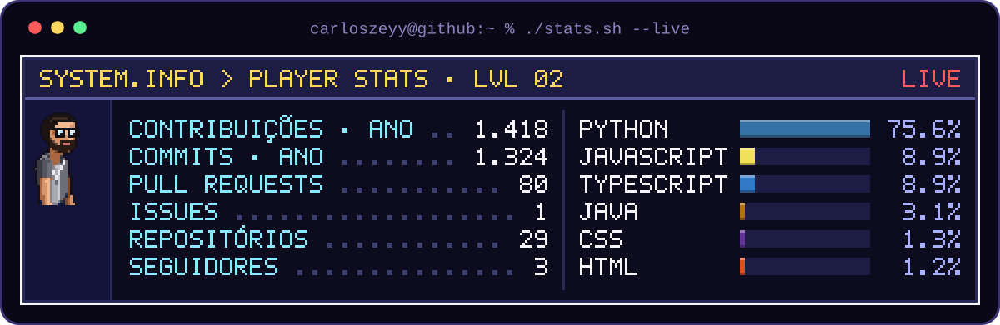

<!-- ===== HERO: jogo 16-bit rodando sozinho (clique para jogar de verdade) ===== -->
<!-- Gerado por scripts/game/build-svg.js a partir de game/shared. Ao trocar o SVG, aumente o ?v= para furar o cache. -->

← → andar &nbsp;·&nbsp; espaço pular &nbsp;·&nbsp; E interagir &nbsp;·&nbsp; funciona no celular

 

<!-- ===== ESTATÍSTICAS DO GITHUB ===== -->

 

<!-- Card próprio, gerado a cada 12 h por scripts/game/build-stats.js (workflow snake.yml) -->

<!-- ===== COBRINHA DE CONTRIBUIÇÕES ===== -->

<picture>
  <source media="(prefers-color-scheme: dark)" srcset="https://raw.githubusercontent.com/CarlosZeyy/CarlosZeyy/output/snake-dark.svg" />
  <source media="(prefers-color-scheme: light)" srcset="https://raw.githubusercontent.com/CarlosZeyy/CarlosZeyy/output/snake-light.svg" />
  
</picture>

 

<!-- ===== PROJETOS ===== -->

## Projetos

**Enfermex — gestão de pacientes** &nbsp;·&nbsp; freelance, em produção
Sistema com 6 módulos usado por uma equipe de enfermagem. Preenchimento de prontuário caiu de 20 para 5 min por paciente e a busca de histórico de 10 min para menos de 1. JWT, validação de COREN, anexos em prontuário e deploy em VPS.
`Java` `Spring Boot` `PostgreSQL` `React` `TypeScript`
[código](https://github.com/CarlosZeyy/EnfermEX) &nbsp;·&nbsp; [app.enfermex.cloud](https://app.enfermex.cloud)

**Sistema de Orçamentos — MV Vidros** &nbsp;·&nbsp; projeto próprio
Orçamento em PDF timbrado gerado e enviado ao cliente por e-mail e WhatsApp. Tempo de criação caiu de 30 para 5 minutos. Microsserviço de WhatsApp em Node/Express, testes com Jest e CI/CD com GitHub Actions em VPS.
`Next.js` `TypeScript` `Zod` `Puppeteer` `Nodemailer` `Docker`
[código](https://github.com/CarlosZeyy/Sistema-MvVidros)

**Calculadora de Investimentos**
Simulação de juros compostos com tabela dinâmica e gráfico em tempo real.
`JavaScript` `Tailwind CSS` `Chart.js`
[código](https://github.com/CarlosZeyy/CalculadoraInvestimentos) &nbsp;·&nbsp; [demo](https://calcinvestimentos.netlify.app/)

**Clone do Spotify**
Réplica da interface com player funcional e navegação entre páginas.
`React` `Node.js` `Express`
[código](https://github.com/CarlosZeyy/frontendSpotifyClone) &nbsp;·&nbsp; [demo](https://frontend-spotify-clone-sepia.vercel.app)

**Full-Stack Quest** &nbsp;·&nbsp; este perfil
O jogo do topo da página: pixel art gerado por código, sem imagens nem dependências. O mesmo cenário alimenta o jogo em canvas e o SVG animado do README.
`JavaScript` `Canvas` `SVG` `GitHub Actions`
[código](https://github.com/CarlosZeyy/CarlosZeyy/tree/main/game) &nbsp;·&nbsp; [jogar](https://carloszeyy.github.io/CarlosZeyy/)

 

<!-- ===== CONTATO ===== -->

&nbsp;&nbsp;

&nbsp;&nbsp;

&nbsp;&nbsp;

 

Se você tem um problema que vale a pena resolver com código, me chama.

